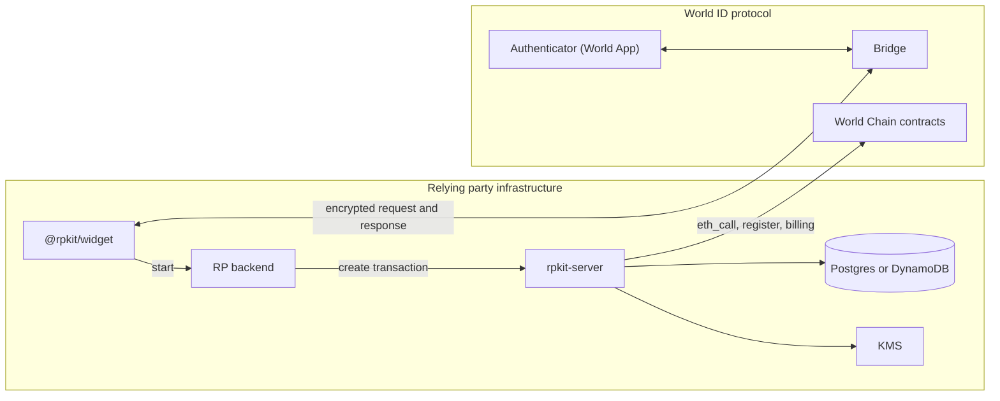
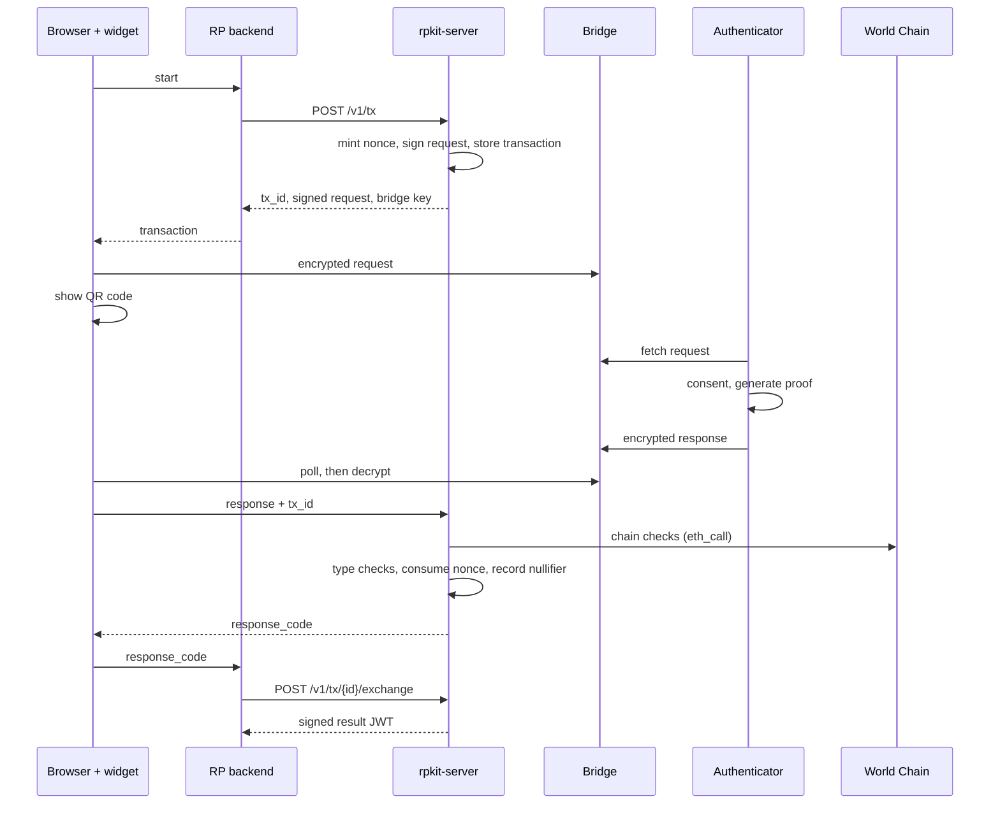

# rpkit specification

Status: draft · Version: 0.1

rpkit is a self-hostable relying-party (RP) implementation for [World ID](https://docs.world.org/world-id). It lets an application request World ID proofs, verify them and pay protocol fees, with no hosted service between the RP and the protocol.

This document describes what rpkit does, how its parts fit together, and which guarantees it gives. It is written for engineers who integrate rpkit, operate it, or contribute to it.

## 1. Motivation

Today a World ID RP depends on two pieces of TFH-run software:

- **IDKit** builds requests in the RP's frontend, shows the QR code and polls the bridge for the answer.
- **The Developer Portal** registers the RP on-chain, verifies proofs and serves the RP's name and logo to World App.

That has four costs:

- **Dependency.** RPs must trust and depend on a hosted service for a decision that the protocol could make on its own.
- **Privacy.** The hosted service sees every verification: which RP, which action, when, the nullifiers and the signals. That gives it a usage record for every RP and every user interaction, which the protocol itself never needs.
- **Gaps.** Important guarantees fall between components and nobody enforces them: a nonce is used once, a nullifier is used once.
- **Speed.** Each new proof type needs work in several places before RPs can use it.

rpkit moves everything an RP needs into one open-source stack the RP runs itself. The protocol's on-chain contracts remain the source of truth.

## 2. Goals and non-goals

### Goals

- **Self-hostable.** An RP can run every rpkit component on its own infrastructure, using only a World Chain RPC endpoint and the World ID protocol.
- **Private.** No third party learns about a verification beyond what the protocol requires (§11.1).
- **Every proof type.** rpkit verifies all World ID proof types, and adding a new one is a contained change.
- **Safe by default.** Nonce and nullifier uniqueness are built in, not left to the integrator. Unknown inputs are rejected, and every component fails closed.
- **Language-neutral.** RP backends in any language integrate through HTTP and standard JWTs. Rust services can link the library directly.
- **Operable.** Health probes, metrics, bounded timeouts and documented failure modes come with the first release.

### Non-goals

- rpkit is not a wallet or authenticator, and it never generates proofs.
- rpkit does not replace protocol infrastructure such as OPRF nodes, the indexer or the contracts.
- rpkit does not issue credentials.

## 3. Terminology

| Term | Meaning |
|---|---|
| RP | Relying party: the application that asks a user for a World ID proof. |
| `rp_id` | The RP's identifier in the on-chain `RpRegistry`. |
| Signer key | The key registered for the RP; it signs every proof request. |
| Manager key | The key allowed to update the RP's registry entry (signer, domain, status). |
| Proof request | A `ProofRequest` from [`world-id-primitives`](https://github.com/worldcoin/world-id-protocol/tree/main/crates/primitives): what the RP asks for, signed by the RP. |
| Proof response | A `ProofResponse`: what the authenticator returns. |
| Proof type | The `proof_type` of a request: `uniqueness`, `session` or `embedding_similarity` today. |
| Nonce | A random value the RP puts in each request. It MUST be accepted at most once. |
| Nullifier | In a `uniqueness` proof, a value derived from the user and the RP's action: the same person always produces the same nullifier for the same action. In a `session` proof, a one-time value bound to a random per-proof action. |
| Session id | A stable, RP-scoped identifier for a user's session. `session` proofs show that the same person is still behind it. |
| Bridge | The encrypted relay that carries requests and responses between the RP's frontend and the user's authenticator. |
| Transaction | One proof request and its lifecycle inside rpkit (§7). |

The key words MUST, SHOULD and MAY are used as in [RFC 2119](https://www.rfc-editor.org/rfc/rfc2119).

## 4. Overview

rpkit has four parts. Only one of them is a service.

| Part | Kind | Responsibility |
|---|---|---|
| `rpkit-core` | Rust library | Builds and signs requests, verifies proofs of every type, defines the storage and signing interfaces. |
| `rpkit-server` | Service (container image, Helm chart) | Runs `rpkit-core` behind an HTTP API. It owns transactions, nonce and nullifier state, keys, registration and billing. |
| `@rpkit/widget` | Frontend component | Shows the QR code or deep link, encrypts the request for the bridge, and hands the response back. It holds no secrets. |
| Edge helpers | Small libraries (TypeScript, Go, Python) | Verify the signed result JWT and webhook signatures that `rpkit-server` emits. |



There are two integration modes:

- **Service mode (default).** The RP runs `rpkit-server` next to its backend, as a sidecar or a shared service. The backend creates transactions and receives a signed result. This is the recommended mode for all languages.
- **Library mode.** A Rust backend links `rpkit-core` directly and provides its own `NonceStore` and `NullifierStore` implementations. Those implementations MUST pass the conformance tests in `rpkit-core`.

## 5. Proof verification

### 5.1 Verifier registry

`rpkit-core` holds one verifier per proof type, keyed by `proof_type`:

```rust
#[async_trait]
pub trait ProofVerifier: Send + Sync {
    /// The proof type this verifier handles.
    fn proof_type(&self) -> ProofTypeId;

    /// Checks `response` against the RP's own `request`.
    async fn verify(
        &self,
        request: &ProofRequest,
        response: &ProofResponse,
    ) -> Result<Verified, VerifyError>;
}
```

The steps around the verifier are the same for every type: request matching, nonce consumption and nullifier recording. A verifier only implements what is specific to its proof type.

A request with a proof type that has no registered verifier MUST be rejected.

### 5.2 Steps for every proof type

For each response, rpkit runs these steps in order and stops at the first failure:

1. **Match.** The response answers this request: same request `id`, and every response item matches a request item and satisfies the request's constraints (`ProofRequest::validate_response`).
2. **Freshness.** The request has not expired (`expires_at`).
3. **Type-specific verification.** The verifier for the request's `proof_type` checks the proof (§5.3).
4. **Nonce.** The request's nonce is consumed atomically (§7.2). A nonce that was already consumed rejects the proof.
5. **Nullifier.** If the proof type produces nullifiers, each one is recorded, unique (§7.3). A nullifier already recorded rejects the proof as `nullifier_reused`.

The nonce is consumed after the proof check, so an invalid proof cannot burn a legitimate request.

What the nullifier step means depends on the proof type:

| Proof type | Nullifier | What uniqueness protects against |
|---|---|---|
| `uniqueness` | Per user and action | The same person acting twice under one action |
| `session` | Session nullifier, one-time | Replay of a session proof; the stable user handle is the `session_id` |
| `embedding_similarity` | None | Not applicable; replay is covered by the nonce |

### 5.3 Proof types

| Proof type | Where it is verified | What the verifier checks |
|---|---|---|
| `uniqueness` | On-chain, through `WorldIDVerifier.verify` (or `verifyProofAndSignals` when bound to a session) with `eth_call` | The Merkle root is valid; the issuer key is registered for the credential schema; the OPRF key for `rp_id` exists; the credential has not expired; the Groth16 proof verifies over the public signals, including `rp_id`, `action`, `nonce` and `signal_hash` |
| `session` | On-chain, through `WorldIDVerifier.verifySession` with `eth_call` | As above, with the session id and session nullifier instead of an action |
| `embedding_similarity` | Off-chain, through [`world-id-rp`](https://github.com/worldcoin/world-id-protocol/tree/main/crates/rp) (WIP-202) | The Flamingo Verifier's Nitro attestation and its key; accepted engine configurations; proof recency; Merkle root and issuer key, both checked on-chain; the AAT policy; the proof itself |

`eth_call` is free and touches no state, so on-chain verification costs the RP nothing beyond RPC usage.

For `embedding_similarity`, the RP stays responsible for one thing rpkit cannot check: the challenge image behind the request's `challenge_hash` must be the image the RP checked against the person it is dealing with. rpkit takes `challenge_hash` as an input when the transaction is created.

Some credentials need checks beyond the proof itself. Integrity bundles for selfie credentials are one example. These run as **credential plugins** that the verifier calls for the matching `issuer_schema_id`.

### 5.4 Adding a proof type

A new proof type needs:

1. a `ProofVerifier` implementation in `rpkit-core`
2. a policy section in the configuration, if the type has RP-chosen parameters
3. test vectors.

The HTTP API, the stores, the result format and billing do not change.

### 5.5 Policy

Some proof types depend on RP choices. These live in a versioned configuration file (TOML), validated at startup. An invalid policy prevents the server from becoming ready.

```toml
[embedding_similarity]
issuer_version = 1
engine_config_hashes = ["0x…"]

[[embedding_similarity.nitro_pcrs]]
pcr0 = "…"
pcr1 = "…"
pcr2 = "…"

[embedding_similarity.aat]
required = true
trust_anchor_key_hashes = ["0x…"]
accepted_flags = [{ platform = 1, sec_level = 2, sec_meta = 0, authenticator_meta = 0 }]
```

Empty allowlists are rejected. rpkit has no "accept anything" default.

## 6. Requests and keys

### 6.1 Request signing

Every proof request carries the RP's signature. Authenticators and OPRF nodes check it against the signer key registered for `rp_id`.

rpkit produces the same signature as IDKit's `signRequest`:

- **Scheme:** EIP-191 `personal_sign` over secp256k1.
- **Message:** `0x01 ‖ nonce (32 bytes) ‖ created_at (u64, big-endian) ‖ expires_at (u64, big-endian) ‖ action (32 bytes, if the proof type has one)`.
- **Nonce:** 32 random bytes, reduced into the BN254 scalar field.

The default request lifetime is 5 minutes. The OPRF nodes accept `created_at` within ±5 minutes of their clock and a lifetime of at most 30 minutes.

### 6.2 Signer interface

```rust
#[async_trait]
pub trait Signer: Send + Sync {
    /// The Ethereum address of the signer key.
    fn address(&self) -> Address;
    /// Signs a 32-byte EIP-191 digest.
    async fn sign_digest(&self, digest: B256) -> Result<Signature, SignerError>;
}
```

Implementations:

- `LocalSigner`: an in-process key, for development and tests only. The server refuses it unless dev mode is set.
- `AwsKmsSigner`: an AWS KMS `ECC_SECG_P256K1` key. This is the production default.
- Further backends (GCP KMS, HashiCorp Vault) implement the same trait.

Keys:

- The **manager key** MUST be a different key from the signer key. It is used only for registry updates.
- **Rotation:** register the new signer with `RpRegistry.updateRp`, signed by the manager key; then switch the server to the new key.
- **One signer per RP.** The signed message does not include `rp_id` (§11), so a signer shared between RPs would let one RP's requests be replayed as another's. rpkit MUST refuse a configuration in which two RPs share a signer address.

## 7. State

### 7.1 Transactions

In service mode each proof request is a transaction:

| Field | Description |
|---|---|
| `tx_id` | Random identifier. |
| `rp_id`, `action`, `proof_type` | What is being asked. |
| `request` | The signed `ProofRequest`. |
| `nonce` | The request's nonce. |
| `bridge_key` | The symmetric key that encrypts the bridge payload. |
| `status` | `created` → `completed` or `failed` or `expired`. |
| `response_code` | One-time code the RP backend exchanges for the result. |
| `result` | The verified result or the failure class. |
| `expires_at` | Equal to the request's `expires_at`. |

Expired transactions are deleted by a background sweep.

### 7.2 Nonces

```rust
#[async_trait]
pub trait NonceStore: Send + Sync {
    /// Atomically marks `nonce` used for `rp_id`. Returns `AlreadyUsed` if it was.
    async fn consume(&self, rp_id: RpId, nonce: FieldElement, expires_at: u64)
        -> Result<Consumed, StoreError>;
}
```

`consume` MUST be atomic across all replicas: a compare-and-set, a unique insert or a conditional write. A store error is reported as `unavailable`, never as success.

### 7.3 Nullifiers

```rust
#[async_trait]
pub trait NullifierStore: Send + Sync {
    /// Records `nullifier`. Returns `AlreadyRecorded` if it exists for `(rp_id, scope)`.
    async fn record(&self, rp_id: RpId, scope: NullifierScope, nullifier: FieldElement)
        -> Result<Recorded, StoreError>;
}
```

`NullifierScope` is the action for `uniqueness` proofs and the session id for `session` proofs.

Retention:
- `uniqueness` nullifiers are kept for as long as the action is in use.
- Session nullifiers can be dropped once the request that carried them has expired.

A reused nullifier is always a rejection: `nullifier_reused` is a terminal error, never a success with a warning.

### 7.4 Backends

| Backend | Use |
|---|---|
| In-memory | Development and tests. The server refuses it outside dev mode. |
| Postgres | Default for production. Migrations run as a separate `rpkit migrate` command, not at startup, so rolling deploys and rollbacks stay safe. |
| DynamoDB | AWS-native option, using conditional writes. |

Every backend passes the same conformance test suite.

## 8. Trust and RP identity

**Who is asking.** The on-chain `RpRegistry` binds `rp_id` to a signer key, a manager key and a domain. Registration is permissionless and pays a registration fee.

At startup, `rpkit-server` MAY register the configured RP itself. Registration is idempotent: rpkit checks the registry first and only registers if the entry is missing. After registration, the protocol generates the RP's OPRF key asynchronously. Until that key exists, proofs fail, so rpkit reports that RP as degraded (§13) and rejects its transactions.

**What the user sees.** The consent screen in World App shows the RP's name, logo and action description. Today World App reads these from the Developer Portal. The protocol is moving to a domain-verified metadata record:

- published under `/.well-known/` on the domain registered in `RpRegistry`
- committed by hash on-chain.

rpkit will serve and publish that record once the format is specified. Until then, an RP still needs a Developer Portal entry for its consent metadata (§12).

## 9. Transport

### 9.1 Cross-device: QR code and bridge

1. The RP backend creates a transaction. rpkit returns the signed request and a fresh bridge key.
2. The widget encrypts the request with AES-256-GCM and posts it to the bridge, which returns a request id.
3. The widget shows a QR code or deep link containing the request id and the key.
4. The authenticator fetches the request, asks the user for consent, generates the proof, and puts the encrypted response on the bridge.
5. The widget polls the bridge, decrypts the response and submits it to rpkit with the `tx_id`.
6. rpkit verifies the proof (§5) and returns a one-time `response_code`.
7. The RP backend exchanges the `response_code` for the signed result.



The result only reaches the RP backend through the code exchange, so a page that tampers with the browser cannot fake a result.

The RP backend MUST link each `tx_id` to the user session that created it, and accept an exchanged result only within that session. This blocks session-swap phishing, where an attacker gets a victim to complete the attacker's transaction. This follows the `response_code` pattern of [OpenID4VP 1.0](https://openid.net/specs/openid-4-verifiable-presentations-1_0.html) and [HAIP](https://openid.net/specs/openid4vc-high-assurance-interoperability-profile-1_0.html).

### 9.2 Same device

Inside World App, the widget hands the request to the app directly instead of using the bridge. Everything after step 5 is the same.

### 9.3 Later: OpenID4VP and the Digital Credentials API

A later version adds an OpenID4VP profile over the browser [Digital Credentials API](https://www.w3.org/TR/digital-credentials/), with the registry acting as the verifier's trust anchor. The bridge stays the default until browsers and authenticators support that profile.

## 10. API

`rpkit-server` listens on two ports: the API port and an admin port that is never exposed publicly.

### 10.1 RP API

Authenticated. In sidecar deployments it is bound to localhost; shared deployments add bearer-token or mTLS authentication. All paths are versioned under `/v1`.

| Method and path | Purpose |
|---|---|
| `POST /v1/tx` | Create a transaction for `{ rp_id, proof_type, action, signal, credentials, constraints }`. Returns `{ tx_id, request, bridge_key, expires_at }`. |
| `GET /v1/tx/{id}` | Transaction status. |
| `GET /v1/tx/{id}/events` | Server-sent events for status changes. A late subscriber receives the current state first. |
| `POST /v1/tx/{id}/exchange` | Exchange a `response_code` for the signed result JWT. One-time. |
| `POST /v1/verify` | Stateless verification of `{ request, response }` for RPs that keep their own nonce and nullifier state. Runs §5.2 steps 1–3 only. |

### 10.2 Wallet-facing API

Public. It receives the response from the widget (`POST /v1/tx/{id}/response`) and, later, OpenID4VP `request_uri` and `direct_post` endpoints.

### 10.3 Results

On success the exchange returns a JWT signed with ES256:

- **Claims:** `iss`, `aud` (the RP), `iat`, `exp`, `tx_id`, `rp_id`, `proof_type`, `action` where present, `session_id` where present, and per response item `issuer_schema_id` and `nullifier` where the proof type has one.
- **Keys:** published at `/.well-known/jwks.json`. A new key is added before use, the newest key signs, and an old key is retired after the longest token lifetime has passed.
- **Webhooks:** optional. Delivered as signed webhooks (id, timestamp and HMAC). Receivers must deduplicate on the id.

### 10.4 Errors

Errors have a stable `code` and a class:

| Class | HTTP | Meaning | Retry? |
|---|---|---|---|
| `invalid` | 422 | The proof or request is rejected: `proof_invalid`, `request_expired`, `nonce_reused`, `nullifier_reused`, `policy_rejected`, `unknown_proof_type`. | No |
| `rp_degraded` | 503 | The RP cannot take proofs right now: `oprf_key_pending`, `billing_capacity_exhausted`. | After the cause is fixed |
| `pending` | 409 | The transaction is not finished yet. | Yes |
| `unavailable` | 503 | A dependency failed: RPC, store or KMS. | Yes, with backoff |
| `bad_request` | 400 | Malformed input. | No |

## 11. Security and privacy considerations

### 11.1 Privacy

What each outside party learns from a verification:

| Party | What it sees |
|---|---|
| TFH / Developer Portal | Nothing on the verification path. The portal only serves consent metadata until the domain-verified record is supported (§15). |
| World Chain RPC provider | The `eth_call` inputs: `rp_id`, nullifier, action, nonce, signal hash and timing. Run your own World Chain node, or use a provider you trust with this. |
| Bridge operator | Encrypted payloads, request ids, timing and client IP addresses. |

rpkit sends no telemetry to anyone. Its metrics and logs never contain nullifiers, signals or session ids.

### 11.2 Security

- **Fail closed.** Unknown proof types, empty policies, unreachable dependencies and store errors all reject. The default configuration exposes nothing publicly and enables no development backends.
- **Replay.**
  - Nonces are single-use (§7.2) and requests are short-lived.
  - The protocol itself does not enforce single-use nonces globally: `WorldIDVerifier` is a view function, and OPRF nodes only filter replays in memory. rpkit's nonce store is the enforcement point.
- **Duplicate humans.** Nullifiers are unique per `(rp_id, action)` (§7.3).
- **Cross-RP replay.**
  - The signed request message does not cover `rp_id`. rpkit refuses shared signers (§6.2).
  - A protocol change adding `rp_id` and the chain id to the signed message (message version `0x02`) is proposed. rpkit will support both versions during the migration.
- **Trust in RPC.** rpkit trusts its World Chain RPC endpoint to answer `eth_call` honestly. Production deployments SHOULD use an RPC they operate or trust, and MAY cross-check across several providers. Cached chain values (valid roots, issuer keys) have short lifetimes, and negative results are never cached.
- **Keys.** Production keys live in a KMS. The signer and manager keys are separate.
- **Inputs.**
  - Request bodies are size-limited and parsed strictly, rejecting unknown fields where the protocol types allow it.
  - Webhook targets are checked against an allowlist and cannot point at private or loopback addresses.

## 12. Fees

World ID charges per-proof fees through the `WorldIDBilling` contract (WIP-107):

- An RP buys monthly capacity in WLD, priced in USD per World ID, with `purchaseCapacity(scope, amount, maxWld)`.
- Billing applies only to RPs flagged for billing, and today only to `embedding_similarity` proofs.
- The user's authenticator registers against the RP's capacity, so the fee is enforced by the protocol, not by rpkit.

rpkit's billing client:

- tops up capacity with a `maxWld` slippage limit
- exposes remaining capacity as a metric
- marks a billed RP as degraded when its capacity is exhausted: transactions for that RP fail fast with `billing_capacity_exhausted`, and the other RPs on the server are unaffected.

A fork of rpkit cannot skip fees, so rpkit needs no license enforcement and stays fully open source.

## 13. Operations

- **Health** (admin port):
  - `/health`: the process is alive.
  - `/ready`: policy loaded; store, RPC and KMS reachable. Any of these failing makes the server not ready.
  - **Per-RP status**, also on the admin port: OPRF key present and billing capacity available. A degraded RP does not affect other RPs on the same server, and its degraded state is exposed as a metric for alerting.
- **Timeouts and retries.** Every remote call has a deadline. Only idempotent calls (`eth_call`, reads) are retried, at most twice, with exponential backoff and jitter. Inbound requests have a concurrency limit and are shed with 503 under overload.
- **Metrics** (DogStatsD/OTLP):
  - verifications by proof type and outcome
  - nonce and nullifier conflicts
  - RPC latency and errors by call
  - cache hits
  - transaction lifecycle
  - billing capacity
- **Logs.** Structured JSON with trace id, `rp_id`, dependency, upstream status and failure class. Failures are logged at warn or error; successes are counted in metrics, not logged.
- **Deployment.**
  - Container images on GitHub Container Registry, signed with build provenance.
  - A first-party Helm chart.
  - Configuration as TOML plus environment variables.

## 14. Versioning

These are versioned independently:

| What | How |
|---|---|
| HTTP API | Path prefix (`/v1`). Breaking changes add a new prefix; the old one stays for at least one minor release. |
| Proof request format | The `version` field of `ProofRequest`, as defined by the protocol. |
| Request signature | The leading message byte (`0x01`, later `0x02`). |
| rpkit releases | Semantic versioning. A release's database schema is compatible with the previous minor release, so rollbacks are safe. |

## 15. Known limitations

- **Bridge.** World App currently accepts only World-operated bridge domains, so rpkit uses the public bridge until authenticators accept other bridges.
- **Consent metadata.** World App currently reads the RP's name and logo from the Developer Portal. Until the domain-verified record (§8) is supported, an RP needs a Developer Portal entry for display purposes, even though verification no longer goes through it.
- **Legacy proofs.** World ID v3 proofs can only be verified by TFH's sequencer, so rpkit does not support them.

## 16. Roadmap

| Phase | Scope |
|---|---|
| 0 | `rpkit-core` with the `uniqueness`, `session` and `embedding_similarity` verifiers; stateless `POST /v1/verify`; container image. |
| 1 | Transactions, nonce and nullifier stores, KMS signer, result JWT, registration, billing, Helm chart. |
| 2 | `@rpkit/widget`, edge helpers, domain-verified metadata, request signature `0x02`. |
| 3 | OpenID4VP / Digital Credentials API profile, conformance test vectors, external audit. |
